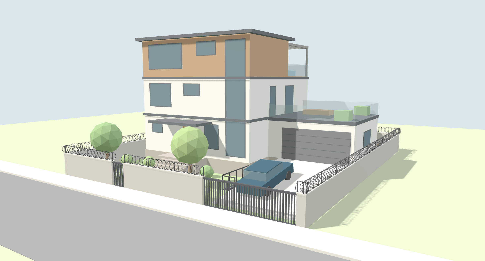
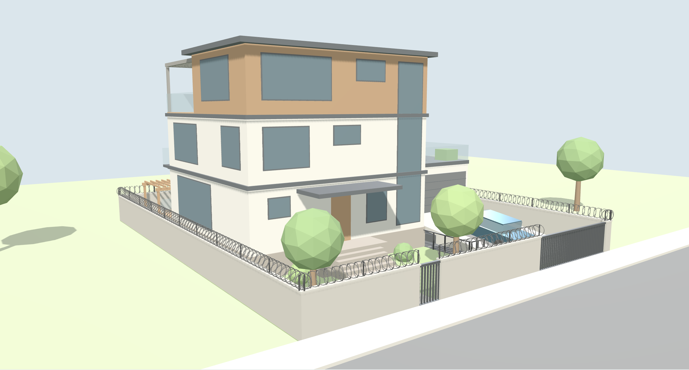
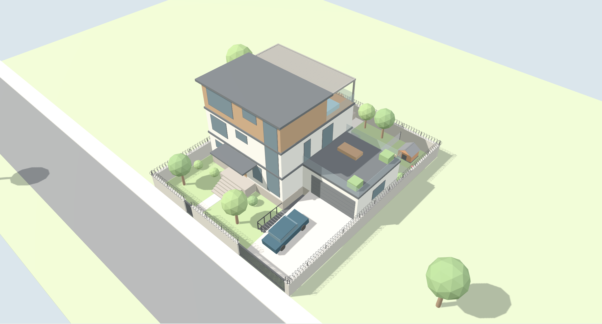
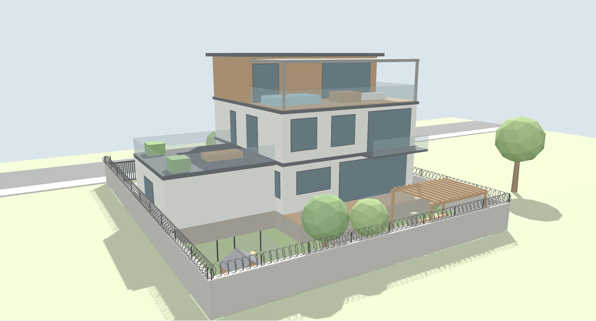
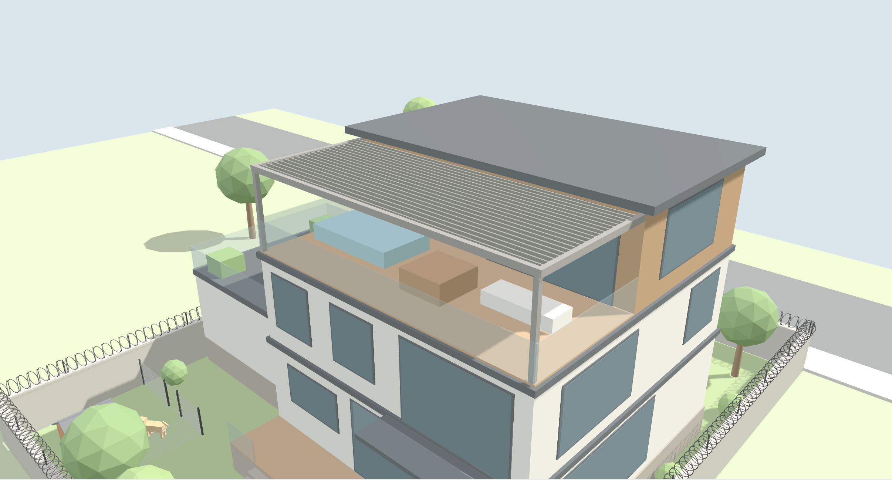
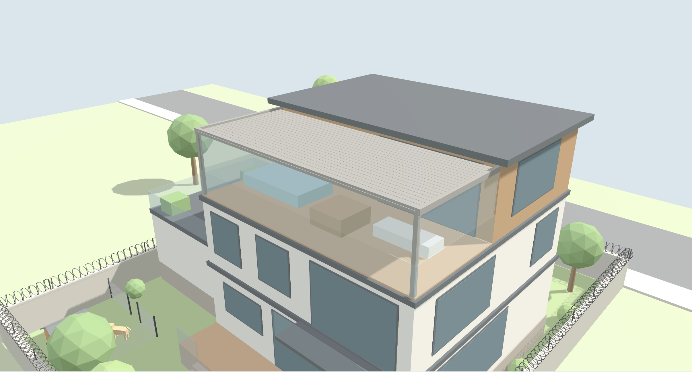

# Bahçeli Müstakil Ev: 500 m² Arsa Konsept Projesi

Etrafı beton duvar ve jiletli telle çevrili 20 × 25 m (500 m²) arsada; bodrum, zemin ve iki kattan oluşan müstakil ev.

**Etkileşimli sunum:** [`ev-tasarimi.html`](ev-tasarimi.html) dosyasını tarayıcıda açın. Sayfada döndürülebilir 3B model, kat planları, kesit ve detaylar var. Teras çatısını model üzerinden açıp kapatabilirsiniz.

## Görseller

| | |
|---|---|
|  |  |
| Sokaktan: rampa ve garaj | Giriş cephesi |
|  |  |
| Kuş bakışı | Arka bahçe, pergola ve köpek kulübesi |
|  |  |
| Çatı terası: lameller açık | Çatı terası: lameller ve cam perdeler kapalı |

Paftalar: [Vaziyet planı](gorseller/vaziyet-plani.png) · [Bodrum](gorseller/bodrum-kat.png) · [Zemin](gorseller/zemin-kat.png) · [1. kat](gorseller/1-kat.png) · [Çatı katı](gorseller/cati-kati.png) · [Kesit A–A](gorseller/kesit-AA.png) · [Çevre duvarı detayı](gorseller/cevre-duvari-detayi.png) · [Tüm pafta](gorseller/tum-pafta.png)

## Yerleşim

- **Arsa:** 20 m cephe × 25 m derinlik. Sokak önde (güney varsayıldı).
- **Çevre:** Dört tarafta 1.80 m betonarme duvar, üstünde Y-konsollara bağlı Ø60 cm jiletli spiral tel (toplam yaklaşık 2.45 m). Önde 6 m motorlu sürgülü araç kapısı ve yaya kapısı var.
- **Ev:** 11 × 11 m gövde. Önde 7 m bahçe, arkada 7 m bahçe, solda 1.50 m yan bahçe.
- **Garaj:** Evin sağında, 7 × 7 m iç ölçü, döşemesi **+1.20**. İki araç 3.50 m'lik ayrı şeritlerde yan yana durur. 5.50 m genişliğindeki seksiyonel kapı ikisini de aynı anda serbest bırakır, yani araçlar birbirini kapatmaz.
- **Rampa:** 6 m geniş, 9 m uzun, ±0.00'dan +1.20'ye %13 eğimle çıkar. Son 3 metresi köprü döşemedir.
- **Bodrum girişi (rampa altı):** Rampanın yanındaki merdivenden −1.80'e inilir. Köprü döşemenin altındaki sahanlıktan (net yükseklik yaklaşık 2.6 m) garajın altındaki spor salonuna çift kanatlı kapıyla girilir.

## Katlar

| Kat | Kot | Mekânlar |
|---|---|---|
| Bodrum | −1.80 | Spor salonu 49 m² (garaj altı), hobi/sinema odası 38 m², depo 18 m², teknik oda 14 m², çamaşırhane, duş/WC, sauna (opsiyonel) |
| Zemin | +1.20 | Giriş holü, misafir WC, vestiyer/kiler, salon + yemek 52.5 m², mutfak 24 m² (garaja kapısı var), arka güverte, iki araçlık garaj |
| 1. kat | +4.40 | 3 yatak odası (14 / 18 / 18 m²), aile oturma odası 30 m² + balkon, banyo, garaj üstü teras 49 m² |
| Çatı katı | +7.60 | Ebeveyn yatak odası 36 m², giyinme odası, ebeveyn banyosu, **açılır-kapanır teras** 49.5 m² |

**Açılır-kapanır teras:** Motorlu alüminyum bioklimatik pergola kullanılır. Lameller açılınca güneş girer, kapanınca çatı yağmur geçirmez. Yanlardaki katlanır cam perdelerle teras tamamen kapatılıp kış bahçesine dönüşür.

**Bahçe:** Arka bahçede çim alan, pergola altında oturma yeri ve mangal var. Sağ arka köşede 1.80 × 1.60 m ahşap köpek kulübesi ve 1.20 m tel örgülü, kapılı koşu alanı (yaklaşık 23 m²) bulunur.

## Alan özeti

| | m² |
|---|---|
| Taban oturumu (ev + garaj) | 170 (%34) |
| Yaşam alanı (zemin + 1. kat + çatı katı) | ~314 |
| Kapalı brüt alan (bodrum ve garaj dahil) | ~532 |
| Teraslar (çatı + garaj üstü) | ~98 |

> Bu bir konsept tasarımdır. Çekme mesafeleri, emsal ve kat yüksekliği belediyenin imar planına göre değişir. Uygulama için mimari ve statik proje gerekir. Jiletli tel kullanımı bazı belediyelerde izne veya yükseklik sınırına tabidir.
